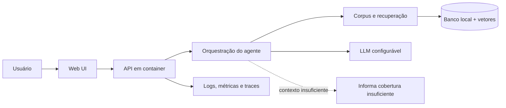

# PantryPilot — Plano Temporário de Implementação

> Documento vivo para guiar as próximas decisões e entregas. Ele será revisado a cada
> etapa; uma decisão aceita deve migrar para o mapa do projeto ou para um ADR quando
> passar a orientar a arquitetura de forma duradoura.

## Direção confirmada

- **Produto:** assistente culinário baseado em ingredientes, tempo e preferências.
- **Entrega:** aplicação local distribuída em containers, sem recursos de cloud.
- **Desenvolvimento:** paridade local por containers, sem depender da cloud para os
  testes determinísticos.
- **Referência de engenharia:** padrões do AI Researcher adaptados ao domínio
  culinário — RAG rastreável, fontes, guardrails, testes e observabilidade.
- **Escopo de portfólio:** demo pública com carga inicial baixa; simplicidade
  operacional tem prioridade sobre componentes distribuídos.

## Arquitetura provisória

O diagrama descreve responsabilidades, não uma escolha definitiva de fornecedores ou
frameworks. O ponto de partida recomendado é uma única aplicação modular em container,
com dados e dependências executados localmente.

## Etapas

### 0. Produto, corpus e restrições

**Objetivo:** confirmar o menor fluxo que entrega valor e definir os limites de
conteúdo e segurança.

- Escolher o recorte do corpus inicial e suas fontes licenciadas.
- Definir quais preferências e restrições entram no MVP.
- Definir a política de fontes, atribuição e conteúdo web com TTL.
- Ambiente definido: execução exclusivamente local, sem recursos de cloud ou serviços
  pagos. Ver ADR-001 para o limite de custo e integrações externas.

**Pronto quando:** uma pergunta de demonstração, uma resposta esperada e as fontes
que a sustentam estiverem documentadas.

### 1. Fundação local e contratos

**Objetivo:** tornar possível desenvolver e testar a aplicação de modo reproduzível.

- Criar a estrutura de aplicação e os contratos UI/API.
- Adicionar Dockerfiles e `compose` para desenvolvimento local.
- Estabelecer convenções de configuração, variáveis de ambiente e segredos.
- Configurar lint, testes e healthcheck básico.

**Pronto quando:** um único comando iniciar as dependências locais e o CI executar
checagens básicas sem credenciais reais.

### 2. Pipeline de conhecimento

**Objetivo:** construir o corpus culinário confiável antes do chat completo.

- Modelar receita, técnica, fonte, licença, ingredientes, porções, tempo, dietas,
  alergênicos e temperatura.
- Normalizar e versionar um corpus pequeno e licenciado.
- Implementar ingestão, chunking, indexação e recuperação com proveniência.
- Comparar PostgreSQL + pgvector com banco vetorial dedicado, priorizando o menor
  custo operacional para o MVP.

**Pronto quando:** consultas de referência determinísticas recuperarem trechos
corretos com fonte e metadados.

### 3. Experiência PantryPilot

**Objetivo:** entregar a jornada de valor do usuário.

- Coletar ingredientes, tempo e preferências.
- Compor resposta fundamentada com receita, ingredientes ausentes e substituições.
- Identificar claramente receita recuperada, adaptação baseada em evidência ou
  sugestão criativa.
- Exibir fontes e uma resposta honesta quando não houver evidência suficiente.
- Adicionar streaming apenas se melhorar perceptivelmente a experiência.

**Pronto quando:** a demo suporta uma jornada completa e uma pergunta fora do corpus.

### 4. Segurança, qualidade e observabilidade

**Objetivo:** tornar o MVP confiável para demonstração pública.

- Implementar guardrails para alergias, conservação e preparo de alimentos crus.
- Adicionar defesa proporcional contra prompt injection e validação de entrada.
- Criar dataset de avaliação e testes de recuperação/resposta com fakes.
- Adicionar logs estruturados, métricas, traces e rate limiting.

**Pronto quando:** os limites de segurança são testados, testes unitários não usam
rede e os fluxos críticos têm rastreabilidade.

### 5. Execução local reproduzível

**Objetivo:** demonstrar o projeto localmente sem credenciais, rede ou custos de
infraestrutura.

- Endurecer as imagens de container e documentar o build local.
- Executar a demo com Docker Compose, dados de exemplo e variáveis locais não
  versionadas.
- Garantir que os testes determinísticos não façam chamadas de rede ou a serviços
  pagos.
- Documentar como encerrar os containers e limpar apenas os volumes de demonstração,
  quando necessário.

**Pronto quando:** a demo pode ser iniciada e encerrada localmente com passos
documentados, sem credenciais de cloud ou cobrança.

### 6. Publicação do portfólio

**Objetivo:** apresentar o PantryPilot como projeto técnico completo.

- Refinar README, diagrama, decisões e instruções de execução.
- Publicar corpus de exemplo que possa ser compartilhado legalmente.
- Incluir capturas da demo, limitações, segurança e notas de custo.

**Pronto quando:** alguém consegue entender, executar e avaliar o projeto pelo
repositório público.

## Registro de decisões

| ID | Estado | Decisão | Alternativas | Consequência / próximo gatilho |
| --- | --- | --- | --- | --- |
| D-001 | Confirmada | Execução local por containers | VMs ou serviços de cloud | Manter `compose` local, dados de exemplo e modo sem rede |
| D-002 | Confirmada | Sem cloud e sem serviços pagos | GCP, AWS, Azure ou outro provedor | Novo provedor exige autorização explícita, orçamento, limites de gasto e ADR própria |
| D-003 | Confirmada | `pantrypilot-quick-recipes-v1`: 100 receitas rápidas de origem polonesa, licenciadas e com proveniência por registro | Outros recortes ou fontes futuras | Define o dataset da demo e o cenário de referência; revisar ao ampliar corpus ou política de fontes |
| D-004 | Pendente | Stack da UI/API e LLM | A definir após o escopo | Evitar dependências prematuras |
| D-005 | Pendente | Armazenamento vetorial | PostgreSQL + pgvector ou banco dedicado | Decidir após volume e consultas iniciais |

## Próxima conversa de decisão

Definir **D-004: a stack mínima local**. O corpus inicial e o cenário de referência já
estão definidos; a próxima escolha deve permitir implementar o fluxo sem rede e sem
serviços pagos.
